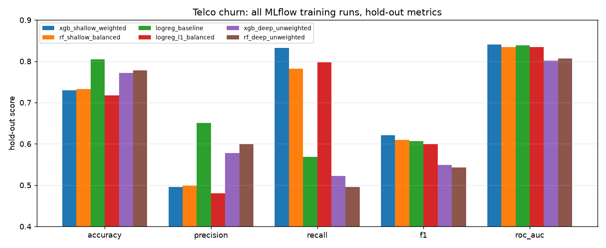

# Track A: Data Science MLOps (Telco Customer Churn)

A binary churn classifier on the IBM Telco Customer Churn dataset (7,043 customers, 19 features,
26.5% churners), brought up to MLOps standards: a locked **uv** environment, **MLflow**
tracking for six model runs, a registry with gated **Staging → Production** promotion, a
**FastAPI** service that loads the model from the registry, **Evidently** drift monitoring with
two custom metrics, and an **Airflow** DAG that retrains when drift crosses a threshold.

```
data ─► training ─► tracking ─► registry ─► serving ─► monitoring ─► retraining (if needed)
data.py  train.py   MLflow      register.py serve.py   drift.py      pipeline.py / Airflow DAG
```

| Deliverable | Where |
| --- | --- |
| `pyproject.toml` + `uv.lock` | [pyproject.toml](pyproject.toml), [uv.lock](uv.lock) |
| Run comparison, all 6 runs | [results/runs_comparison.md](results/runs_comparison.md) (+ [.csv](results/runs_comparison.csv), [chart](results/runs_comparison.png)), [MLflow UI screenshot](results/screenshots/mlflow_compare_runs.png) |
| Registry and stage transitions | [results/model_registry.json](results/model_registry.json), [registry screenshot](results/screenshots/mlflow_model_registry.png), [v1](results/screenshots/mlflow_model_version_1.png) / [v2](results/screenshots/mlflow_model_version_2.png) |
| Evidently HTML reports | [reports/](reports/): data drift, target drift + custom metrics, model performance (drifted and control) |
| Drift interpretation data | [results/drift_summary.json](results/drift_summary.json), [results/drift_summary_control.json](results/drift_summary_control.json) |
| Retraining outcome | [results/retraining_result.json](results/retraining_result.json) |
| Airflow DAG | [dags/churn_drift_retrain_dag.py](dags/churn_drift_retrain_dag.py) |

---

## Quick start

```bash
git clone -b track-a-data-science https://github.com/Amit3729/wk_17MLops.git
cd wk_17MLops/track_a_churn

# Option 1: conda env managed by uv (how this project was developed)
conda create -n mlops python=3.12 -y && conda activate mlops
export UV_PROJECT_ENVIRONMENT="$CONDA_PREFIX"
uv sync --frozen --inexact     # --inexact leaves conda's own pip/setuptools installed

# Option 2: no conda, uv creates .venv
uv sync --frozen

uv run churn-pipeline          # the whole workflow, ~40 s on a laptop
uv run pytest                  # 11 tests
```

`churn-pipeline` downloads the CSV (and checks its SHA-256), trains six models, registers
the best one, exports the comparison, runs the drift checks, and retrains because drift is
detected. The individual steps are:

| Step | Command | Output |
| --- | --- | --- |
| Train + track 6 runs | `uv run churn-train` | MLflow experiment `telco-churn-training` |
| Register best, Staging → Production | `uv run churn-register` | model `telco-churn-classifier` |
| Export comparison | `uv run churn-compare` | `results/runs_comparison.*` |
| Drift check (control + drifted) | `uv run churn-drift` | `reports/*.html`, experiment `telco-churn-monitoring` |
| Retrain (challenger vs champion) | `uv run churn-pipeline --retrain-only` | experiment `telco-churn-retraining`, registry v2 |
| Serve (FastAPI) | `uv run churn-serve` | <http://127.0.0.1:8000/docs> |
| MLflow UI | `uv run mlflow ui --backend-store-uri sqlite:///mlflow.db` | <http://127.0.0.1:5000> |

Serving the model from the registry:

```bash
uv run churn-serve                     # loads models:/telco-churn-classifier@production
curl -s localhost:8000/health
# {"status":"ok","model_uri":"models:/telco-churn-classifier@production","version":2,"stage":"Production",...}
curl -s -X POST localhost:8000/predict -H 'content-type: application/json' -d '{
  "gender":"Female","SeniorCitizen":"No","Partner":"Yes","Dependents":"No","tenure":2,
  "PhoneService":"Yes","MultipleLines":"No","InternetService":"Fiber optic","OnlineSecurity":"No",
  "OnlineBackup":"No","DeviceProtection":"No","TechSupport":"No","StreamingTV":"Yes",
  "StreamingMovies":"Yes","Contract":"Month-to-month","PaperlessBilling":"Yes",
  "PaymentMethod":"Electronic check","MonthlyCharges":95.5,"TotalCharges":191.0}'
# {"churn_probability":0.9213,"churn":true,"threshold":0.5}       (scored by v1)

# MLflow's built-in server works against the same registry
MLFLOW_TRACKING_URI=sqlite:///mlflow.db uv run mlflow models serve \
  -m "models:/telco-churn-classifier@production" -p 5001 --env-manager local
```

The FastAPI wrapper validates every field against the dataset's categories (for example,
`"Contract": "Weekly"` gets a 422 response), returns a probability instead of a bare label,
and reports which registry version is serving. To serve the Staging model instead, set
`CHURN_MODEL_URI=models:/telco-churn-classifier@staging`.

### Layout

```
track_a_churn/
├── pyproject.toml, uv.lock, .python-version   # locked env (Python 3.12)
├── src/churn/
│   ├── config.py               # paths, seeds, thresholds: every number quoted below lives here
│   ├── data.py                 # download + checksum, cleaning, 70/30 split, drift injection
│   ├── features.py             # shared ColumnTransformer (scaler + one-hot)
│   ├── train.py                # 6 candidates -> MLflow runs (params, metrics, plots, model)
│   ├── register.py             # best run -> registry, gated Staging -> Production
│   ├── compare.py              # exports the side-by-side run table
│   ├── serve.py                # FastAPI, loads models:/...@production
│   ├── monitoring_metrics.py   # 2 custom Evidently metrics
│   ├── drift.py                # Evidently reports + retrain policy, logged to MLflow
│   └── pipeline.py             # end-to-end run + challenger/champion retraining
├── dags/churn_drift_retrain_dag.py
├── tests/                      # data, custom metrics, retrain policy, train->register->serve
├── data/                       # raw CSV + generated reference / current_clean / current_drifted
├── reports/                    # Evidently HTML
└── results/                    # exported comparison, registry, drift + retrain summaries, screenshots
```

`mlflow.db` and `mlartifacts/` are gitignored: they contain absolute paths and are rebuilt by
`uv run churn-pipeline`. The exports in `results/` are the committed record of that store.

---

## a. Environment & reproducibility (uv)

These are the dependency problems uv solves for this particular project:

1. **Airflow and the serving API disagree on FastAPI.** `apache-airflow-core` 3.3 requires
   `fastapi<0.137`, while an unconstrained `pip install fastapi` gets 0.141. uv resolves the
   main dependencies and the optional `airflow` group into **one** lock (209 packages). When I
   added the group, it refused the combination and pointed at the conflict. Constraining
   `fastapi>=0.129,<0.137` (it resolved to 0.136.3) means the serving code runs on the same
   FastAPI that Airflow will pull in, instead of breaking the first time someone installs Airflow.
2. **A registered model is only loadable with matching library versions.** MLflow 3.16 saves
   the sklearn pipeline with skops, which serialises sklearn's internal `Tree` and xgboost's
   `Booster` objects. The lock pins `scikit-learn==1.9.1` and `xgboost==3.4.1`, so the model
   that `churn-serve` or the Airflow retrain task loads is the one the training run produced.
   Before this, the sklearn/xgboost pairing was whatever each machine happened to have installed.
3. **The API changes between sklearn versions.** sklearn 1.8 deprecated `LogisticRegression(penalty=...)`
   (removal is planned for 1.10), so the logistic-regression runs use `l1_ratio` instead. The lock
   stops a future `pip install -U` from turning that warning into a crash.
4. **The Python version is pinned.** The machine's default Python is 3.14. `.python-version`
   pins 3.12 and `requires-python = ">=3.12,<3.13"` stops uv from resolving for any other version.
   uv downloads 3.12 if it isn't installed.
5. **The data is pinned as well.** `data.py` checks the CSV's SHA-256 (`16320c9c…`), and every
   split, drift injection and model uses `SEED = 42`. Running the pipeline twice from scratch gives
   identical metrics (checked: all six hold-out F1 and ROC-AUC values matched across runs).

**Clean-clone check.** I cloned the `track-a-data-science` branch into a fresh temporary
directory and ran `uv sync --frozen` (a new `.venv`, with nothing reused from the working copy),
then `uv run churn-pipeline` and `uv run pytest`. It reproduced the same six-run table,
registered v1, and passed all 11 tests. `--frozen` makes uv fail instead of silently
re-resolving if `uv.lock` and `pyproject.toml` ever drift apart.

Airflow is an opt-in group, so the default environment stays lean:
`uv sync --inexact --group airflow` (see section d).

---

## b. Experiment tracking strategy (MLflow)

**Setup.** MLflow uses a SQLite backend (`sqlite:///mlflow.db`, which the Model Registry needs)
and a local artifact store. The data is split once: 70% is the *reference* set (4,930 rows).
Inside it, an 80/20 stratified split gives 3,944 training rows and a 986-row hold-out that
every run is scored on. The other 30% is kept aside for monitoring (section c).

**What varied, and why.** There are six configurations across three model families. Within
each family, the hyperparameters change the model's behaviour (capacity, regularisation, and
whether the 2.8:1 class imbalance is corrected), not just the seed:

| Run | Family | Key hyperparameters | Hypothesis tested |
| --- | --- | --- | --- |
| `logreg_baseline` | LogReg | C=1.0, L2, no class weights | What an accuracy-optimised model does on an imbalanced target |
| `logreg_l1_balanced` | LogReg | C=0.1, L1 (`l1_ratio=1`), `class_weight=balanced` | Does reweighting buy recall? |
| `rf_shallow_balanced` | Random forest | 300 trees, max_depth=8, min_leaf=5, balanced_subsample | Non-linear model, depth-limited |
| `rf_deep_unweighted` | Random forest | 100 trees, max_depth=None, min_leaf=1 | Overfitting end of the forest |
| `xgb_shallow_weighted` | XGBoost | 400 trees, depth 3, lr 0.05, subsample 0.8, `scale_pos_weight`=2.77 | Slow, shallow boosting with imbalance correction |
| `xgb_deep_unweighted` | XGBoost | 600 trees, depth 7, lr 0.1, no weighting | High-variance boosting |

**What is logged for every run.**
- *Parameters*: all estimator hyperparameters (`model__*`), plus the data lineage: row counts,
  training churn rate, dataset hash, split seed.
- *Metrics*: hold-out accuracy, precision, recall, F1, ROC-AUC, PR-AUC and log-loss; 5-fold CV
  ROC-AUC and F1 (mean and std) on the training split; train F1 and ROC-AUC; the overfitting gap
  (train − test ROC-AUC); fit time; and prediction latency per 1,000 rows.
- *Artifacts*: the model (with signature and input example), `confusion_matrix.png`,
  `roc_curve.png`, `pr_curve.png`, `classification_report.json` and `feature_importance.csv`.
- *Tags*: model family and a one-line rationale for the configuration.

**Selection rule, fixed before looking at the results:** highest hold-out **F1 on the churn
class**, with ROC-AUC as the tie-break (`config.SELECTION_METRIC`). Only 26.5% of customers
churn, so a model that predicts "no churn" for everyone already scores 73.5% accuracy.
Accuracy is therefore reported but never used to choose a model.

### Results: all six runs

Exported from MLflow by `churn-compare` ([csv](results/runs_comparison.csv),
[MLflow UI](results/screenshots/mlflow_compare_runs.png)). Bold marks the best value in each column.

| Run | Accuracy | Precision | Recall | **F1** | **ROC-AUC** | PR-AUC | CV ROC-AUC | CV F1 | Overfit gap | Fit (s) | ms / 1k rows |
|---|---|---|---|---|---|---|---|---|---|---|---|
| **xgb_shallow_weighted** | 0.730 | 0.495 | **0.832** | **0.621** | **0.841** | **0.668** | 0.846 | **0.636** | 0.066 | 0.30 | 6.8 |
| rf_shallow_balanced | 0.733 | 0.499 | 0.782 | 0.609 | 0.835 | 0.652 | **0.848** | 0.633 | 0.068 | 0.38 | 32.7 |
| logreg_baseline | **0.804** | **0.651** | 0.569 | 0.607 | 0.838 | 0.665 | 0.845 | 0.592 | **0.012** | **0.02** | 5.3 |
| logreg_l1_balanced | 0.717 | 0.480 | 0.798 | 0.600 | 0.835 | 0.656 | 0.844 | 0.624 | 0.014 | 0.04 | **5.3** |
| xgb_deep_unweighted | 0.772 | 0.578 | 0.523 | 0.549 | 0.801 | 0.584 | 0.819 | 0.555 | 0.199 | 0.85 | 8.0 |
| rf_deep_unweighted | 0.778 | 0.599 | 0.496 | 0.543 | 0.807 | 0.574 | 0.824 | 0.558 | 0.193 | 0.16 | 20.4 |



### Which model was registered, and why

**`xgb_shallow_weighted` was registered as version 1.** The decision rests on these numbers:

- It has the **highest F1 (0.621) and the highest ROC-AUC (0.841)**, and also the best PR-AUC
  (0.668) and recall (0.832). It finds 83% of churners in the hold-out.
- `logreg_baseline` has the **highest accuracy (0.804)** and precision (0.651), but its recall
  is only **0.569**: it misses 43% of the customers who actually leave. That 7.4-point accuracy
  lead comes from predicting the majority class more often, which is the imbalance trap the
  selection rule is designed to avoid.
- The F1 margin over the runner-up is small (0.621 vs 0.609 on 986 rows), so I checked it against
  cross-validation. The ranking holds: the XGBoost model also has the best **CV F1 (0.636 ± 0.018)**.
  `rf_shallow_balanced` has a marginally higher CV ROC-AUC (0.848 vs 0.846), but the difference is
  inside one standard deviation (±0.005 / ±0.008). It is also **~5× slower to score**
  (32.7 vs 6.8 ms per 1k rows) and loses on hold-out F1, ROC-AUC and PR-AUC.
- The two unconstrained models (`*_deep_unweighted`) overfit, with train−test ROC-AUC gaps of
  0.19–0.20 against 0.066 for the winner. Depth limits and imbalance correction mattered more than
  the choice of model family.

**The trade-off accepted:** precision falls to 0.495, so about half of the customers the model
flags would not have churned. For a retention campaign that is usually the right trade, because a
wasted discount offer costs far less than a lost subscriber. If contacting a customer were
expensive, the decision threshold (currently 0.5) is the setting to tune, not the model.

### Registry and stage transitions

`churn-register` carries out the transitions with gates, and records the reason for each one as a
model-version tag (visible in the [v1 screenshot](results/screenshots/mlflow_model_version_1.png)):

| Version | Source run | Transitions | Gate |
| --- | --- | --- | --- |
| v1 | `xgb_shallow_weighted` (training) | None → **Staging** → **Production** → Archived | Staging: highest `test_f1` among finished runs (0.6211). Production: the model was reloaded from `@staging` and reproduced hold-out F1 0.6211 exactly. Archived automatically when v2 was promoted. |
| v2 | `xgb_shallow_weighted` retrained after drift | None → **Staging** → **Production** | Beat v1 on the *recent* hold-out: F1 0.646 vs 0.622, ROC-AUC 0.772 vs 0.725 (section c) |

Each promotion sets both the classic stage (what the brief asks for; deprecated in MLflow 3 but
still supported) and the equivalent alias (`@staging`, `@production`). The server loads
`models:/telco-churn-classifier@production`, so a promotion takes effect when the server restarts,
with no code change. See the [registry screenshot](results/screenshots/mlflow_model_registry.png)
and [model_registry.json](results/model_registry.json).

---

## c. Monitoring & drift strategy (Evidently AI)

### Reference vs. current

| Set | Contents | Role |
| --- | --- | --- |
| **reference** (`data/reference.csv`) | Random, stratified 70%: 4,930 rows | "Training-time" data. The Production model was trained and validated on it. |
| **current, drifted** (`data/current_drifted.csv`) | The remaining 30% (2,113 rows) **with synthetic drift injected** | "Incoming production" data |
| **current, clean** (`data/current_clean.csv`) | The same 30%, untouched | A **control**: the monitor must *not* alert on it |

The control matters because a drift monitor that flags everything is useless. Running the same
suite on unperturbed data shows the thresholds aren't too sensitive.

**Injected drift** (`data.inject_drift`, all seeded):
1. **Categorical skew:** rows are resampled so `Contract == "Month-to-month"` makes up **80%**
   of the set (54.8% in reference).
2. **Numeric shift:** `MonthlyCharges += Uniform($10, $30)` per row, simulating a price rise.
3. **Label drift:** **8%** of "No churn" labels are flipped to "Churn".

### What is monitored

| Report | Contents |
| --- | --- |
| [data_drift_report.html](reports/data_drift_report.html) | `DataDriftPreset` over all 19 features. Evidently chooses the test per column: normalised Wasserstein distance for numeric columns and Jensen-Shannon distance for categorical ones, both with threshold 0.1 (the defaults for more than 1,000 rows). The dataset-level test fires if ≥ 30% of columns drift. |
| [target_drift_report.html](reports/target_drift_report.html) | Target drift (`ValueDrift` on `Churn`), prediction drift (`ValueDrift` on the predicted label and on the churn probability), plus **two custom metrics with tests** |
| [model_performance_report.html](reports/model_performance_report.html) | `ClassificationPreset`: Production model on the reference hold-out vs. on the labelled current set |
| `*_control_report.html` | The same three reports against the clean current set |

**Custom metrics** ([monitoring_metrics.py](src/churn/monitoring_metrics.py)) are built on
Evidently's `SingleValueMetric` / `SingleValueCalculation` API, so they appear in the HTML report
and take Evidently tests just like the built-in metrics:
- `MeanDifference(column="MonthlyCharges")`: the absolute change in mean monthly charge, in
  dollars. Test: ≤ $5. A drift score says the distribution *moved*; this says by how much money,
  which is the figure a pricing team acts on.
- `SegmentRateShift(target="Churn", segment_column=…, segment_value=…)`: the absolute change in
  churn rate, either overall or within one segment. It runs twice: overall, and for
  `Contract == "Month-to-month"`. Test: ≤ 0.05.

### What the reports showed

| Check | Control (clean) | Drifted | Detected? |
| --- | --- | --- | --- |
| `MonthlyCharges` drift (Wasserstein) | 0.028 | **0.638** | ✅ perturbed column, flagged |
| `Contract` drift (Jensen-Shannon) | 0.004 | **0.192** | ✅ perturbed column, flagged |
| `tenure` drift | 0.018 | **0.343** | flagged (side effect, see below) |
| `TotalCharges` drift | 0.042 | **0.262** | flagged (side effect, see below) |
| Other 15 features | all < 0.03 | all < 0.08 | not flagged |
| Features drifted | **0 / 19** | **4 / 19** (21%) | dataset-level test (≥ 30%) did not fire |
| Target drift, `Churn` (Jensen-Shannon) | 0.00 | **0.102 → FAIL** | ✅ label drift flagged |
| Prediction drift, churn probability | 0.015 | **0.377 → FAIL** | |
| Custom: \|Δ mean MonthlyCharges\| | $0.63 ✅ | **$19.28 → FAIL** | ✅ (injected mean offset: $20) |
| Custom: \|Δ churn rate\| overall | 0.000 ✅ | **0.136 → FAIL** | ✅ (26.5% → 40.1%) |
| Custom: \|Δ churn rate\|, month-to-month | 0.005 ✅ | 0.040 ✅ | not flagged (see below) |
| Production model ROC-AUC (hold-out → current) | 0.841 → 0.835 | 0.841 → **0.746** | |
| Production model F1 (hold-out → current) | 0.621 → 0.626 | 0.621 → **0.647** | misleading (see below) |

On the control set, every test passed and nothing was flagged, so there were no false positives.

### Interpretation

- **Both perturbed features were caught**, and they rank at the top: `MonthlyCharges` (0.638) and
  `Contract` (0.192). The custom metric measured a $19.28 increase in mean charge, which matches
  the $10–30 uniform offset I injected (expected mean: $20).
- **`tenure` and `TotalCharges` were never touched, yet both drifted.** This is *correlated*
  drift. Month-to-month customers are newer (their share went from 55% to 80%, and mean tenure
  fell from 32.5 to 24.0 months), and `TotalCharges` ≈ tenure × monthly charge follows tenure.
  So the monitor correctly reports a changed customer mix, not just the columns I edited. In
  production, the lesson is to read drifted columns as a group before blaming each one separately.
- **Target drift was detected**, since churn rose from 26.5% to 40.1%. The segment metric shows
  where that rise comes from. Within month-to-month contracts the rate moved only 4.0 points
  (42.9% → 46.9%, under the 5-point limit), so most of the global jump comes from the **mix
  shift** toward the highest-churn contract type. The flipped labels add the rest. Without the
  segment metric, the global number would suggest customers had become more likely to churn
  across the board.
- **What this means for the model:** its ranking ability degraded. ROC-AUC fell from 0.841 to
  **0.746** because the relationship between features and churn changed (flipped labels, and
  price no longer meaning what it meant during training). F1 actually *rose* (0.621 → 0.647),
  but only because F1 depends on prevalence: with 40% positives, even a weaker ranker gets more
  true positives. That is why the retrain policy checks the prevalence-independent ROC-AUC as well
  as F1. With only an F1 check, this model would have looked healthier while getting worse.

### Action on drift: the retrain policy

`drift.retrain_decision` recommends retraining if **any** of these holds (thresholds are in
`config.py`):
≥ 30% of features drift · target drift · a custom-metric test fails · F1 drops by > 0.05 ·
**ROC-AUC drops by > 0.05**.

For the drifted batch, four triggers fired: target drift, the $19.28 charge shift, the 0.136
churn-rate shift, and the 0.095 ROC-AUC drop. The dataset-level share (21%) did not, which is why
the per-signal rules matter. The pipeline then **retrained**, using a champion/challenger setup:
- The **challenger** is the same configuration as the champion, trained on reference data plus
  70% of the labelled current batch.
- Both challenger and champion are scored on the **other 30% of the current batch**, which
  represents the new distribution.
- The challenger is promoted to Production only if its F1 is higher *and* its ROC-AUC is no
  worse. Otherwise it stays in Staging for a person to review.

| Recent hold-out (634 rows) | Champion v1 | Challenger v2 |
| --- | --- | --- |
| F1 | 0.622 | **0.646** |
| ROC-AUC | 0.725 | **0.772** |
| Recall | 0.728 | **0.795** |

v2 was promoted and v1 was archived. ROC-AUC recovered only partly (0.772, against 0.841 before
drift), which is expected: 8% of the new labels are random flips that no model can learn. In a
real system, a label-drift signal this large would also be a reason to audit how churn labels are
being recorded, not just to retrain.

Each drift check is logged to the MLflow experiment `telco-churn-monitoring`, with the three HTML
reports as artifacts (`evidently_reports/`), per-column drift scores, custom-metric values, model
quality and a `retrain_recommended` flag. So the history of drift checks sits next to the training
runs.

---

## d. Orchestration (Airflow bonus)

[dags/churn_drift_retrain_dag.py](dags/churn_drift_retrain_dag.py), DAG id `telco_churn_drift_monitoring`:

```
check_drift ──► decide ──┬──► retrain_and_evaluate ──► notify
                         └──► no_drift_detected  ──► notify
```

- **Schedule:** weekly, Mondays at 06:00 UTC (`0 6 * * 1`), no catch-up, one retry.
- **check_drift** runs the same `run_drift_check` as the CLI: Evidently reports, MLflow logging,
  and the summary pushed to XCom. The batch path defaults to the drifted set and can be changed
  per run with `--conf '{"current_path": "data/current_clean.csv"}'`.
- **decide** (`BranchPythonOperator`) branches on `retrain_recommended`, which comes from the
  policy in section c. The DAG adds no thresholds of its own, so the CLI and the scheduler can
  never disagree.
- **When drift is detected**, `retrain_and_evaluate` runs the challenger/champion retrain. The
  challenger reaches Production only if it wins on the recent hold-out; otherwise it waits in
  Staging. `notify` then logs an ALERT line naming the drifted columns, the triggers that fired,
  and whether a new version was promoted. That log line is where you would hook in Slack or email.
- **No drift:** the retrain task is skipped, and `notify` reports that the Production model is
  unchanged.

**Verified with Apache Airflow 3.3.2** in an isolated copy of the project with its own MLflow
store. `airflow dags test` on the drifted batch ran every task successfully and promoted v2. The
same test with `current_path=data/current_clean.csv` took the `no_drift_detected` branch and
skipped retraining.

```bash
uv sync --inexact --group airflow
export AIRFLOW_HOME=$PWD/.airflow AIRFLOW__CORE__DAGS_FOLDER=$PWD/dags AIRFLOW__CORE__LOAD_EXAMPLES=False
uv run airflow db migrate
uv run airflow dags test telco_churn_drift_monitoring 2026-09-28                    # drift -> retrain
uv run airflow dags test telco_churn_drift_monitoring 2026-09-29 \
    -c '{"current_path": "data/current_clean.csv"}'                                 # control -> skip
uv run airflow standalone                                                           # UI + scheduler
```

The DAG needs a trained and registered model to exist, so run `uv run churn-pipeline` once first.

---

## Limitations

- The drift is synthetic, and "production" is a fixed CSV. A real deployment would read the
  batch path from a date-partitioned store.
- The retrain policy uses labelled current data. In production, labels arrive weeks after the
  predictions, so the label-free signals (feature drift, prediction drift, the `MonthlyCharges`
  metric) would be the early warning and the label-based checks would confirm later.
- The decision threshold is fixed at 0.5. Tuning it on validation data against a business cost
  matrix would be the next improvement.
