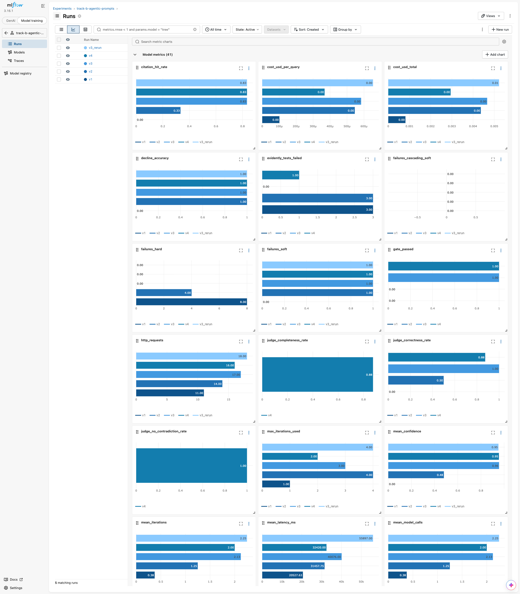
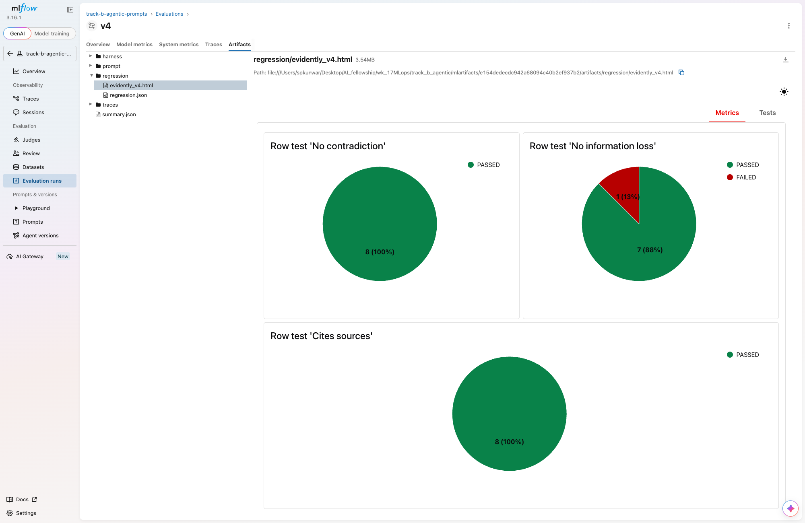

# Track B: Agentic AI MLOps (W15 assistant + W16 agentic feature)

The W15 retrieval-augmented engineering assistant and its W16 agentic feature, brought
under MLOps: a locked **uv** environment, **MLflow** runs for every prompt/config
version with the full step-by-step agent trace of every query, an **Evidently**
LLM-as-a-judge regression suite with a promotion gate, and a nightly **Airflow** DAG.

The assistant is the W15/W16 code, carried over rather than rewritten: FastAPI + ChromaDB
RAG over the CPython 3.14 manual (544 pages, 13,657 chunks, ONNX `bge-small` embeddings),
the W15 tool-calling loop (`search_knowledge_base`, `calculator`, `current_time`) and the
W16 planner → parallel researchers → synthesiser team. Its original write-up is in
[docs/W15_W16.md](docs/W15_W16.md). This week added tracing to both agent modes
([app/llm.py](app/llm.py), [app/agents.py](app/agents.py)) and the `mlops/` package.

| Deliverable | Where |
| --- | --- |
| Source code (W15 assistant + W16 agentic feature + this week) | [app/](app/), [eval/](eval/), [mlops/](mlops/), [dags/](dags/), [tests/](tests/) |
| `pyproject.toml` + `uv.lock` | [pyproject.toml](pyproject.toml), [uv.lock](uv.lock) |
| Versioned prompts, and why each changed | [prompts/prompt_v1.txt … prompt_v4.txt](prompts/), [prompts/versions.json](prompts/versions.json), [prompts/CHANGELOG.md](prompts/CHANGELOG.md) |
| Representative traces (success + failure per version) | [traces/v1 … v4](traces/); every trace of every run is in `results/runs/<run>/traces/` and in MLflow |
| MLflow run comparison (exported) | [results/mlflow_runs_comparison.md](results/mlflow_runs_comparison.md) + [.csv](results/mlflow_runs_comparison.csv) |
| MLflow UI screenshots | [metric charts](results/screenshots/00_metric_charts.png), [runs](results/screenshots/01_runs_table.png), [compare](results/screenshots/02_compare_runs.png), [traces](results/screenshots/03_traces.png), [run detail](results/screenshots/04_run_detail.png), [artifacts](results/screenshots/05_run_artifacts.png), [one trace's span tree](results/screenshots/06_trace_detail.png), [Evidently report in a run](results/screenshots/07_evidently_in_mlflow.png) |
| Golden regression set | [regression/golden.jsonl](regression/golden.jsonl), [how it was reviewed](regression/README.md) |
| Evidently HTML reports | [reports/](reports/) (`evidently_<run>.html`); per-case verdicts in `results/runs/<run>/regression.json` |
| Promoted version | [results/production.json](results/production.json) (v4) |
| Airflow DAG | [dags/nightly_regression_eval.py](dags/nightly_regression_eval.py) |

---

## Quick start

```bash
git clone -b track-b-agentic-ai https://github.com/Amit3729/wk_17MLops.git
cd wk_17MLops/track_b_agentic

uv sync --frozen                                   # .venv with Python 3.12 and the exact locked versions
cp .env.example .env                               # then set GROQ_API_KEY=... (free key: console.groq.com)
make docs                                          # download the CPython 3.14 HTML docs (8 MB archive)
make ingest                                        # build the Chroma index (embeds 13,657 chunks on CPU)
make test                                          # 133 tests, no network, no API key
```

The only prerequisite is [uv](https://docs.astral.sh/uv/getting-started/installation/).
uv downloads Python 3.12 if it isn't installed, and every command goes through `uv run`, so
there is no environment to activate. `make` is optional: each target is one `uv run` line
in the [Makefile](Makefile).

| Step | Command | Output |
| --- | --- | --- |
| One tracked prompt/config version | `make experiment PROMPT=v3` (`uv run python -m mlops.run_experiment --prompt v3`) | MLflow run in experiment `track-b-agentic-prompts`, `results/runs/<name>/`, `traces/<name>/`, and the regression suite run inline |
| Golden candidates from a baseline run | `make golden RUN=results/runs/v3` | `regression/golden_candidates.jsonl`, to review by hand into `golden.jsonl` |
| Re-judge a stored run | `make regression RUN=results/runs/v4` | `reports/evidently_<name>.html`, `results/runs/<name>/regression.json`, metrics logged into that run |
| Gate-checked promotion | `make promote RUN_NAME=v4` | `results/production.json`, refused if the gate failed |
| Export the comparison | `make export` | `results/mlflow_runs_comparison.{csv,md}` |
| Nightly cycle without Airflow | `make nightly` (`make nightly-dry` makes no API calls) | `results/nightly/<run>.json` |
| MLflow UI | `make mlflow-ui` | <http://127.0.0.1:5000> |

Every run needs `GROQ_API_KEY` in `.env` (see [.env.example](.env.example)). The model is
fixed: `openai/gpt-oss-120b` on Groq, for the assistant and for the judge.

---

## a. Environment & reproducibility (uv)

The W15/W16 project shipped a `requirements.txt` that pinned 13 top-level packages and
left everything underneath them floating. This week added MLflow, `evidently[llm]` and an
optional Airflow layer on top, which is where that stopped being enough. uv replaces it
with `pyproject.toml` plus a `uv.lock` pinning all **303** packages. These are the problems
it solves here:

1. **Airflow and the API disagreed on FastAPI.** `requirements.txt` pinned
   `fastapi==0.141.1`, but `apache-airflow-core` 3.3 requires `fastapi<0.137`. uv
   resolves the main dependencies and the optional `airflow` group into **one** lock,
   so it refused the combination instead of letting a later `pip install apache-airflow`
   silently downgrade FastAPI under the running API. The constraint is now
   `fastapi>=0.129,<0.137` (locked at 0.136.3), with the reason written next to it.
2. **The retrieval stack's native pieces were unpinned.** Retrieval quality depends on
   the exact embedding runtime: `chromadb` 1.5.9 and `fastembed` 0.7.4 were pinned, but
   `onnxruntime` and `tokenizers` underneath them were not. The lock fixes them at 1.30.0
   and 0.22.2, so a clean install embeds a query exactly the way the committed index and
   results did.
3. **The LLM judge brings its own client stack.** `evidently[llm]` (0.7.23) pulls in
   `litellm` (1.83.0), which is how the judge talks to Groq. The judge's parsing and retry
   behaviour are part of the regression signal, so they are locked too, as is `openai`
   3.14.1 for the assistant itself.
4. **Python is pinned.** The machine's default Python is 3.14. `.python-version` pins
   3.12 and `requires-python = ">=3.12,<3.14"` keeps uv from resolving for anything else;
   uv downloads 3.12 if it's missing.
5. **What is not locked, on purpose.** The CPython docs corpus (66 MB) and the Chroma
   index built from it (210 MB) are too large to commit, so they are gitignored and rebuilt
   by `make docs && make ingest`. docs.python.org republishes the archive with each 3.14.x
   patch release, so a later download can differ slightly from the one these results were
   produced with. `data/chroma/manifest.json` records the fingerprint of what was indexed
   (544 documents, 13,657 chunks).

Airflow is an opt-in group (`uv sync --group airflow`), so the default environment stays
lean.

**Clean-clone check.** I copied exactly the files git would commit (161 files, 18 MB: no `.env`,
`.venv`, MLflow store, docs corpus or index) into a fresh directory, then ran `uv sync --frozen`,
which built a new `.venv` from `uv.lock` alone, and `uv run pytest`: **133 passed**. The tests
mock the LLM and need no network or API key. `--frozen` makes uv fail rather than silently
re-resolve if `uv.lock` and `pyproject.toml` ever disagree. Running real experiments additionally
needs `GROQ_API_KEY` and the `make docs && make ingest` step.

---

## b. Experiment tracking strategy (MLflow)

**What was varied, and why.** The system prompt is the main variable: four versioned files,
[prompt_v1.txt](prompts/prompt_v1.txt) to [prompt_v4.txt](prompts/prompt_v4.txt), registered with
their configuration in [prompts/versions.json](prompts/versions.json). The config values that
changed with them are `top_k` (per search and for the pre-retrieved context), `max_iterations`,
and `recover_tool_answers` (a loop-level fix, explained below). `temperature` stayed at 0.2 so it
wasn't a confound. The **model is fixed**, `openai/gpt-oss-120b` on Groq with `reasoning_effort=low`,
and so is the **agent mode**: the W15 single tool-calling loop. The W16 multi-agent team spends
~7.7k tokens a query against Groq's 8,000 tokens/minute limit, so it couldn't be run at this scale;
its tracing is in place and tested, and its W16 comparison is in [docs/W15_W16.md](docs/W15_W16.md).
Every version was run on the **same 8 queries** (a fixed subset of the W16 harness, in
`mlops/common.py: CASE_IDS`): 5 Python-docs questions, 1 about the project's own notes, 1
arithmetic question, and 1 out-of-corpus question the assistant must decline.

**What is logged per run** (MLflow experiment `track-b-agentic-prompts`):
- *Params*: prompt version and file, provider, model, temperature, `top_p`, `top_k`,
  `max_iterations`, `reasoning_effort`, `recover_tool_answers`, agent mode, query set.
- *Metrics*: the W16 harness numbers (task completion, tool correctness, citation hit rate,
  decline accuracy, soft/hard failures), the loop's behaviour (mean iterations, share ending by
  error or by hitting max iterations), cost (tokens in and out per query, tokens per step, USD at
  Groq's published price of $0.15 / $0.60 per 1M tokens), latency (p50 and p95, both wall-clock and
  **net** of rate-limit waits), and the regression results (`pct_tests_passed`, per-check pass
  rates, `gate_passed`).
- *Artifacts*: the prompt text; **every query's full trace** (`traces/all/`) plus the representative
  ones (`traces/representative/`); the harness report and results; `responses.jsonl`; the Evidently
  HTML and `regression.json`.
- *Traces*: each query is also an MLflow trace (an `AGENT` span per query, a `TOOL` span per tool
  call, and the OpenAI-client LLM spans via `mlflow.openai.autolog`), so it can be browsed in the
  UI next to the run's params and metrics.

**The trace format.** One JSON record per model turn, written by the agent loop itself
([app/llm.py](app/llm.py) `step_record`). This is step 1 of `v4/arith-units`, verbatim:

```json
{"step": 1, "agent": "agent", "decision": "call_tools", "tools_offered": true,
 "reasoning": "We need compute expression. Use calculator.",
 "recovered_from": "", "content": "",
 "tool_calls": [{"name": "calculator",
                 "arguments": {"expression": "16535 * 4096 / 1048576"},
                 "result": {"expression": "16535 * 4096 / 1048576", "result": 64.58984375}}],
 "prompt_tokens": 1646, "completion_tokens": 43, "model_calls": 1, "latency_ms": 457}
```

`decision` is one of `call_tools`, `final_answer` or `error`. `reasoning` is gpt-oss's own
reasoning field, i.e. why it chose that tool or chose to stop. Each trace also records
`iterations` and `termination` (`success`, `max_iterations`, or `error` with the provider's
message). An exception keeps the steps recorded up to that point (`AgentRunError`), so failure
traces are never empty. 2–3 representative traces per version, a success and a failure where
both exist, are committed under [traces/](traces/).

### The trace-driven chain v1 → v2 → v3 → v4

Every version answers a specific failure found in the previous version's traces. The full
evidence, with the quoted steps, is in [prompts/CHANGELOG.md](prompts/CHANGELOG.md).

| From | What the traces showed | Change |
| --- | --- | --- |
| **v1** (the W15 prompt, verbatim) | **8/8 runs ended in HTTP 400** `tool_use_failed`: gpt-oss wrapped its *finished, correct* answer in a call to a tool named `json`, which doesn't exist ([trace](traces/v1/failure__int-error__error.json)). The W15 prompt says "reply with a single JSON object" while offering tools, and Groq can't combine JSON mode with tools. | **v2**: a rule saying there's no `json` tool and the answer must be written as the message text. Prompt only, config unchanged. |
| **v2** | The pseudo-tool call survived in **4/8** runs despite the rule, so a prompt can reduce it but not remove it. 4/8 answered on turn 1 **without searching** (`dataclass-json`: *"never called search_knowledge_base"*). `int-error` spent **15,819 tokens (60% of the run)** on three vague searches. | **v3**: search before answering, with the exact API name and `source` filter, **at most two searches**, cite only retrieved documents. Plus **`recover_tool_answers`**: the loop accepts a rejected `json` pseudo-call *only* when it carries a finished answer, and marks that step `recovered_from`. |
| **v3** | Correct and error-free, but paying twice for the same text: `json-indent` used **5,460 tokens** reading `json.html` chunks it had already been pre-fed (pre-retrieval `top_k` 4 plus a search at `top_k` 5). No query used more than 3 of its 4 turns. | **v4**: `top_k` 3 for both, shorter answers, `max_iterations` 3. Made after the golden set was frozen. |

### Results: all versions

Exported from MLflow by `make export` ([results/mlflow_runs_comparison.md](results/mlflow_runs_comparison.md),
[.csv](results/mlflow_runs_comparison.csv)). 8 queries per run. Latency is **net** of Groq
rate-limit waits; cost is at Groq's published gpt-oss-120b price.

| Run | Completion | Tool correct | Citation hit | Ended in error | Mean turns | Tokens in / out per query | Total tokens | p50 / p95 latency (s) | Cost (USD) | `pct_tests_passed` | Gate (≥ 80%) |
|---|---|---|---|---|---|---|---|---|---|---|---|
| v1 | 0% | 0% | 0% | **100%** | 0.4 | 591 / 21 | 4,896 | 1.3 / 3.4 | 0.0008 | 6%¹ | ❌ fail |
| v2 | 50% | 38% | 33% | 50% | 1.2 | 3,159 / 120 | 26,228 | 1.9 / 4.7 | 0.0044 | 50%¹ | ❌ fail |
| v3 | **88%** | **100%** | **83%** | 0% | 2.1 | 3,335 / 138 | 27,784 | 2.1 / 3.8 | 0.0047 | 100%¹ ² | ✅ pass |
| v3_rerun | **88%** | **100%** | **83%** | 0% | 2.2 | 3,902 / 113 | 32,120 | 2.3 / 4.3 | 0.0052 | pending¹ | pending |
| **v4** | **88%** | **100%** | **83%** | 0% | **2.0** | **2,094 / 89** | **17,468** | **1.8 / 2.7** | **0.0029** | **96%** | ✅ **pass → promoted** |

¹ Scored by the first version of the suite, which had one combined LLM judge (see section c).
The two-judge re-runs of v2 and v3_rerun were blocked by Groq's 200K-tokens/day cap and are retried automatically as the budget refills; this table is updated when they land. ² Circular: the golden references were reviewed
from v3's own answers.



**Which version wins, and at what cost: v4.** v3, v3_rerun and v4 are tied on every quality
metric (88% completion, 100% tool correctness, 83% citation hit, no errors), and v4 passes the
regression gate with the non-circular two-judge suite (96%). It does that for **37% fewer tokens
than v3** (17,468 vs 27,784; **46% fewer** than the v3 re-run), **38% lower cost**, a turn budget of
3 instead of 4 (every query finished in 2), and the lowest p95 latency (2.7 s vs 3.8 s). The trade-off it makes is **shorter
answers**, and the regression suite shows where that costs something: the `tz-convert` answer
dropped `zoneinfo.ZoneInfo`, which the "no information loss" judge failed (7/8). That loss is
inside the gate's tolerance, so v4 was promoted, but it's the first case to watch.

How each earlier version lost, in one line each:
- **v1 → v2** fixed *delivery*, not knowledge: v1's answers were right but never arrived
  (100% HTTP 400). Tokens went up 5×, because v2 actually completes turns.
- **v2 → v3** fixed *search behaviour*: completion 50% → 88% and tool correctness 38% → 100%,
  for only +6% tokens. v3 searches more on purpose but stops wasting searches.
- **v3 → v4** fixed *cost*: same quality, −37% tokens.

The v3 re-run is the noise check. With an identical config it reproduced v3's quality exactly,
but used 16% more tokens, all from `int-error` taking 4 turns instead of 3 despite the "at most
two searches" rule. So token differences under ~20% between single runs of 8 queries are noise;
v4's −37% is well outside that.

---

## c. Monitoring & regression testing (Evidently AI)

**Reference vs. current.** The *reference* is [regression/golden.jsonl](regression/golden.jsonl):
one approved answer for each of the 8 fixed queries. The *current* data is whatever a new
prompt/config version answers to those same 8 queries. The references were generated from the
best version at the time (v3) with `make golden`, then **checked by hand against the indexed
documentation**. 4 were approved as-is and 4 were corrected; for example, v3 claimed vLLM was
chosen for "low-latency, high-concurrency inference", which `serving.md` never says. Each row's
`review` field records what was checked. The procedure is in [regression/README.md](regression/README.md).

**The checks** ([mlops/regression.py](mlops/regression.py)), each an Evidently row-level test:

| Check | Type | Fails when |
| --- | --- | --- |
| **No contradiction** | LLM judge, `BinaryClassificationPromptTemplate` (`consistent` / `contradicts` + reasoning) | The answer states something the reference shows is wrong, or answers confidently when the reference says the docs don't cover it |
| **No information loss** | LLM judge, `BinaryClassificationPromptTemplate` (`complete` / `incomplete` + reasoning) | The answer omits a key fact the reference relies on, leaves part of the question unanswered, or is empty |
| **Cites sources** | Deterministic | An answerable question cites none of the expected documents, or an unanswerable one isn't declined |

The two judge checks are the brief's "does it **contradict** or **lose** information in the
reference" asked **separately**, so a failure says which way the answer regressed. The judge is
gpt-oss-120b on Groq with `reasoning_effort=low`.

**The gate.** `pct_tests_passed` = passed checks / all checks (8 cases × 3 checks). Below
**80%**, the version is a regression and `make promote` refuses it. The result is logged to the
version's MLflow run (`pct_tests_passed`, `judge_no_contradiction_rate`, `judge_completeness_rate`,
`regression_citation_rate`, `gate_passed`, plus a `gate` tag), together with the Evidently HTML
and `regression.json`. The HTML reports: [v1](reports/evidently_v1.html), [v2](reports/evidently_v2.html),
[v3](reports/evidently_v3.html), [v4](reports/evidently_v4.html).



### Results

| Run | No contradiction | No information loss | Cites sources | `pct_tests_passed` | Promotion |
|---|---|---|---|---|---|
| v4 | 8/8 | **7/8** (`tz-convert`) | 8/8 | **96%** | ✅ promoted: `promoted v4: pct_tests_passed 96% meets the 80% gate` |
| v3_rerun | pending | pending | pending | pending¹ | not evaluated yet |
| v2 | 4/8 correct¹ (combined) | ← | 4/8 | 50%¹ | ❌ refused: `not promoted: pct_tests_passed 50% is below the 80% gate` |
| v1 | 0/8 correct¹ (combined) | ← | 1/8 | 6%¹ | ❌ refused |

¹ The first suite version, with one combined judge.

**Which cases failed, and why:**
- **v1**: all 8. Every answer is empty, because each run ended in the HTTP 400 pseudo-tool error.
  The one "cites" pass is the arithmetic question, which needs no citation.
- **v2**: the 4 runs that still hit the 400 (`json-indent`, `read-lines`, `tz-convert`,
  `project-serving`) produced empty answers and failed both checks. The other 4 passed.
- **v4**: `tz-convert` only. The judge's reasoning: *"The reference answer emphasizes using
  zoneinfo.ZoneInfo for IANA time zones … The provided answer only shows creating an aware
  datetime with datetime.timezone.utc and converting to a fixed-offset timezone, never mentioning
  ZoneInfo or the replace method."* This is a real loss caused by v4's "keep the answer short" rule.

### Judge sanity check: does the judge agree with me?

I read every v2 and v4 response against its reference before looking at the judge's verdict.

| Run / case | Judge | My verdict | Agree? |
|---|---|---|---|
| v2: 4 empty answers | incorrect | incorrect: nothing to grade | ✅ |
| v2: arith-units, dataclass-json, int-error, out-of-corpus-pricing | correct | correct (the decline is right, and the int-error answer is one sentence but has the key fact) | ✅ |
| v4 json-indent, int-error, dataclass-json, arith-units, out-of-corpus-pricing | pass | pass | ✅ |
| v4 **tz-convert** | contradiction: pass, **loss: fail** | **fail**, and worse than the judge says: the example labels a fixed −5 h offset "US/Eastern", which is wrong for half the year under DST | ✅ on the verdict; the judge missed the misleading label |
| v4 read-lines | pass | pass, but thin: drops the `readline()` / `list(f)` alternatives and attaches `readline()`'s end-of-file rule to the `for` loop | ⚠️ lenient |
| v4 project-serving | pass | key facts right, but adds "making it efficient for high-volume inference", which `serving.md` doesn't say | ⚠️ not caught |

**What this says about the judge.** It's reliable on the failures that matter most (empty,
wrong or missing answers), and splitting it in two made it stricter where it counts. The first,
combined judge **passed** v4's `tz-convert` answer, even noting in its reasoning that ZoneInfo was
missing; the dedicated information-loss judge **failed** it. Two biases remain:
1. **Leniency** when the headline fact is right and only secondary detail is missing (read-lines).
2. **Blindness to additions.** Both checks compare against the reference, so an extra unsupported
   claim that doesn't contradict it passes (project-serving). Catching that needs a groundedness
   judge against the retrieved context, which wasn't run: it would put each query's
   retrieved chunks (1–5k tokens in the traces) into every judge call, against Groq's 200K/day cap.

So a passing suite means "no lost or contradicted facts", not "no hallucination", and a person
still reads the traces before promotion.

**What happens on a regression.** A version below the gate is never promoted (`make promote`
exits with the reason), and its MLflow run is tagged `gate=failed`, `stage=rejected`. The
nightly DAG (section d) re-runs the *promoted* version every night against the same references,
so drift on the provider's side (Groq updating the model) shows up as a failing nightly run and
an alert, not as a silent change in production.

---

## d. Orchestration (Airflow bonus)

[dags/nightly_regression_eval.py](dags/nightly_regression_eval.py), DAG id `nightly_regression_eval`:

```
run_eval ──► branch_on_degradation ──┬──► alert_degradation
                                     └──► report_ok
```

- **Schedule:** nightly at 02:00 UTC (`0 2 * * *`), no catch-up, one retry after 10 minutes,
  and a 2-hour timeout on `run_eval` (Groq's rate limit makes a full run take several minutes).
- **run_eval** re-runs the **promoted** prompt/config (`results/production.json`, written only
  by `make promote`) through the harness and the Evidently suite, as a new MLflow run named
  `nightly-<version>-<timestamp>`. The same queries, the same golden references and the same
  judge are used, so any movement comes from the model/provider side or from the environment.
- **branch_on_degradation** (`BranchPythonOperator`) compares that run with the production
  baseline and goes to `alert_degradation` if any of these holds:
  - `pct_tests_passed`, `task_completion_rate` or `citation_hit_rate` fell by **more than
    10 points**;
  - `mean_tokens` rose by **more than 50%** (a cost regression);
  - `pct_tests_passed` is below the **80% promotion gate**.
- **On degradation**, `alert_degradation` prints a `[REGRESSION]` line naming each metric
  that moved and by how much, and writes `results/nightly/ALERT.txt`. That's the hook for a
  Slack or email notifier. Production is **not** changed automatically: a degraded nightly run
  means someone reads its traces before anything is promoted or rolled back.
- Otherwise `report_ok` runs, and the comparison is kept in `results/nightly/<run>.json`.

All of the decision logic lives in [mlops/nightly.py](mlops/nightly.py) as plain functions
(`compare_to_baseline`, `choose_branch`) that are unit-tested without Airflow; the DAG file only
wires them together. It imports cleanly when Airflow isn't installed.

**Verified with Apache Airflow 3.3.2**, in an isolated copy of the project (its own `.venv`
from `uv sync --frozen --group airflow`, its own `AIRFLOW_HOME`). Both branches were run with
`airflow dags test`, in dry-run mode so no Groq calls were spent:

| Test | Environment | Path taken | Result |
| --- | --- | --- | --- |
| Baseline vs itself | `NIGHTLY_DRY_RUN=1` | `run_eval` → `branch_on_degradation` → **`report_ok`** | `alert_degradation` skipped, DagRun success |
| Simulated bad change | `NIGHTLY_DRY_RUN=1 NIGHTLY_SIMULATE_DEGRADATION=1` | `run_eval` → `branch_on_degradation` → **`alert_degradation`** | `[REGRESSION] … pct_tests_passed fell 1.00 -> 0.75 (> 0.10 allowed); task_completion_rate fell 0.88 -> 0.62 (> 0.10 allowed); pct_tests_passed 75% is below the 80% gate`, and `ALERT.txt` written |

```bash
uv sync --group airflow
export AIRFLOW_HOME=$PWD/.airflow AIRFLOW__CORE__DAGS_FOLDER=$PWD/dags AIRFLOW__CORE__LOAD_EXAMPLES=False
uv run airflow db migrate
NIGHTLY_DRY_RUN=1 uv run airflow dags test nightly_regression_eval 2026-09-27                                 # ok path
NIGHTLY_DRY_RUN=1 NIGHTLY_SIMULATE_DEGRADATION=1 uv run airflow dags test nightly_regression_eval 2026-09-28  # alert path
uv run airflow dags test nightly_regression_eval 2026-09-29      # a real nightly run: ~8 queries + judge calls on Groq
```

The DAG needs a promoted baseline (`results/production.json`) first: run `make promote RUN_NAME=<version>`.

---

## Limitations

- **Small sample.** 8 queries per version, so one query is 12.5 points of completion. Differences
  of one case (v3 vs v4 on any single metric) are within run-to-run noise: the v3 re-run with an
  identical config used 16% more tokens than v3, because `int-error` took 4 turns instead of 3.
- **One model, one agent mode.** Every number is gpt-oss-120b on Groq in the W15 single loop. The
  v1 failure (the pseudo-tool `json`) is specific to that model/provider pair; the same prompt
  worked on OpenAI in W15.
- **Groq free-tier limits shaped the design.** 8,000 tokens/minute and **200,000 tokens/day** for
  gpt-oss-120b. Runs are paced from Groq's rate-limit headers, one query at a time; wall-clock
  latency is dominated by those waits, which is why net latency is reported separately. The daily
  cap is why the query set is 8 cases, and why no groundedness judge against the retrieved
  context was run.
- **Golden-set provenance.** The references were reviewed from v3's answers, so v3's own
  regression score is partly circular; the honest regression numbers are v3_rerun and v4 (see c).
- **`recover_tool_answers` is a code change, not a prompt change.** v3 combines a prompt revision
  with that loop fix, because v2's traces showed the prompt alone couldn't stop the pseudo-tool
  call. It's a config flag, off for v1/v2, so their numbers are as measured.
- **The corpus is re-downloaded, not pinned.** See section a, point 5.
